<div align="center">


# Claude in Safari

**A Safari Web Extension plus a local MCP server that lets Claude work in your real Safari — the way "Claude in Chrome" works in Chrome.**

[🇷🇺 Русский](README.md) · 🇬🇧 English

</div>

> ⚠️ **Unofficial project.** Not affiliated with or endorsed by Anthropic; "Claude" is a trademark of Anthropic.
>
> 🔐 **Security.** The extension lets an MCP client (Claude) drive your *real* Safari: see tabs, read pages, click and type wherever you are signed in. Enable it only if you understand that. The port is protected from websites (Origin + token), and `~/.claude-in-safari/policy.json` lets you block sites and require confirmation before actions (see "Security" below). Put banks and admin panels under `blocked`.

Claude sees your tabs, reads pages, clicks, types, takes screenshots and runs JavaScript — in the same Safari where you are already signed in. No separate browser, no re-authentication.

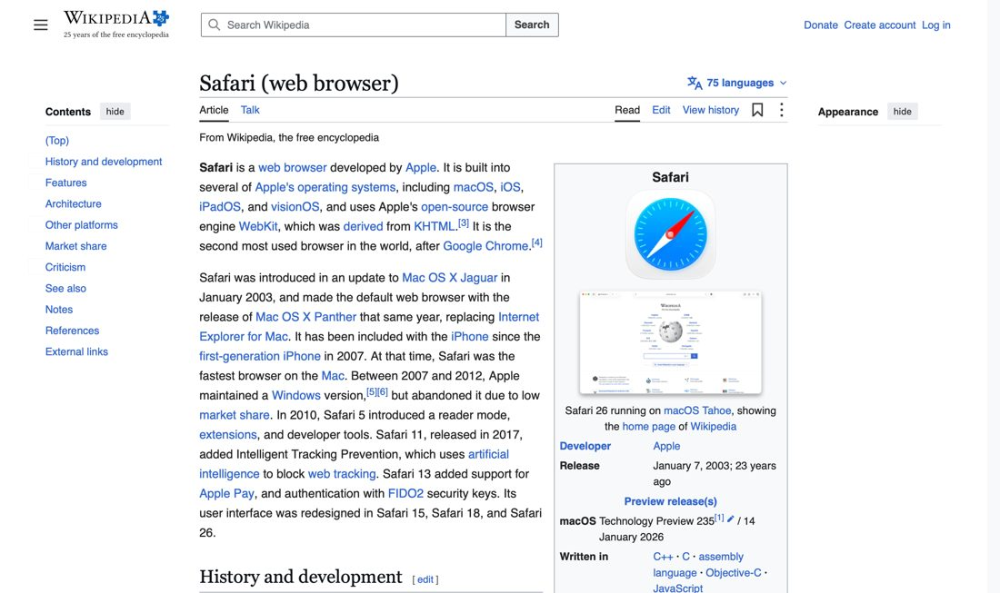

## Features

| Group | Tools |
|---|---|
| Tabs | `safari_tabs`, `safari_new_tab`, `safari_close_tab`, `safari_activate_tab`, `safari_navigate`, `safari_frames`, `safari_history` |
| Reading | `safari_read_page` (interactive elements with refs, `query` filter), `safari_get_text` |
| Actions | `safari_click` (left / double / right / hover, by ref or x,y), `safari_type`, `safari_key` (with modifiers), `safari_form_input`, `safari_scroll`, `safari_wait` |
| Screenshots | `safari_screenshot`, `safari_fullpage_screenshot` (stitched whole page), `safari_resize` |
| Vision | `safari_ocr` — on-device text recognition via Apple Vision (Russian + English), with coordinates so you can click text on canvas and images |
| Debugging | `safari_console` (console.*, page errors), `safari_network` (fetch/XHR: method, URL, status, time) |
| JavaScript | `safari_eval` (the extension's isolated world), `safari_eval_page` (the page's own world: `window`, page variables, frameworks) |
| System | `safari_screen_point` — screen coordinates of an element for a real (trusted) click from a system-level tool |

Open shadow DOM and iframes are supported, cross-origin ones included: `safari_frames` lists a tab's frames, and the `frame` parameter of `read_page`, `click`, `type`, `get_text`, `eval_page` and others sends the command into the chosen frame.

### Full-page screenshot

`safari_fullpage_screenshot` scrolls the page, captures it in steps and stitches the result:

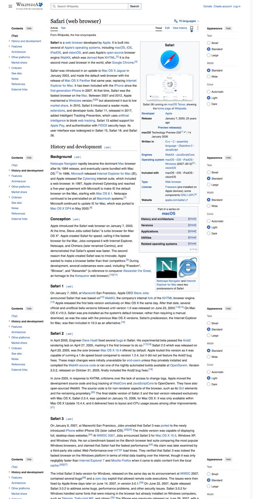

### Test page

`tools/` contains a page with all the awkward cases (select, checkbox, shadow DOM, iframes, canvas) and the self-check script `tools/feature_test.py`:

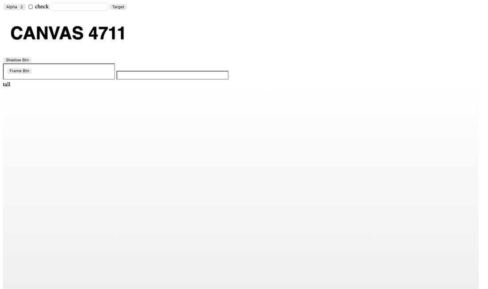

## How it works

```
Claude Desktop ──stdio──> MCP server (Swift) ──WebSocket 127.0.0.1:18765──> Safari extension ──> page
                                                                              │
                                                                              └─ native messaging ─> Swift (Vision OCR)
```

- The first MCP server instance takes the port and becomes the "hub"; others join it as clients and relay requests.
- The extension's background page keeps a WebSocket open and reconnects automatically.
- Everything stays on `127.0.0.1`; nothing leaves your machine.
- Access to the port is restricted: from a browser only the extension's own Origin is accepted (ordinary websites always send their own Origin and are refused); every other client must present the secret from `~/.claude-in-safari/token` (created automatically, mode 600).

## Install from a release

1. Download `Claude-in-Safari.dmg` from [Releases](https://github.com/KLon777/claude-in-safari/releases/latest) and drag **Claude in Safari.app** to Applications.
2. The app is built without a paid certificate, so Safari loads its extension only after one of the options below: **sign it with your own certificate** (recommended) or **allow unsigned extensions**.
3. Open the app → enable **Claude in Safari** in Safari → Settings → Extensions and allow all websites.
4. The wizard copies "Claude Safari Server" to `/Users/Shared` and adds the server to the Claude Desktop config; then fully restart Claude Desktop (details below).

## Step-by-step installation (with pictures)

Screenshots were taken on a Russian-language macOS; menu names in English are given in brackets or in the text.

**You need:** a Mac with macOS and Safari 16.4+, a free Apple ID, and Claude Desktop.

**1. Open the disk image.** Download `Claude-in-Safari.dmg` from [Releases](https://github.com/KLon777/claude-in-safari/releases/latest) and double-click it. The window shows three steps.

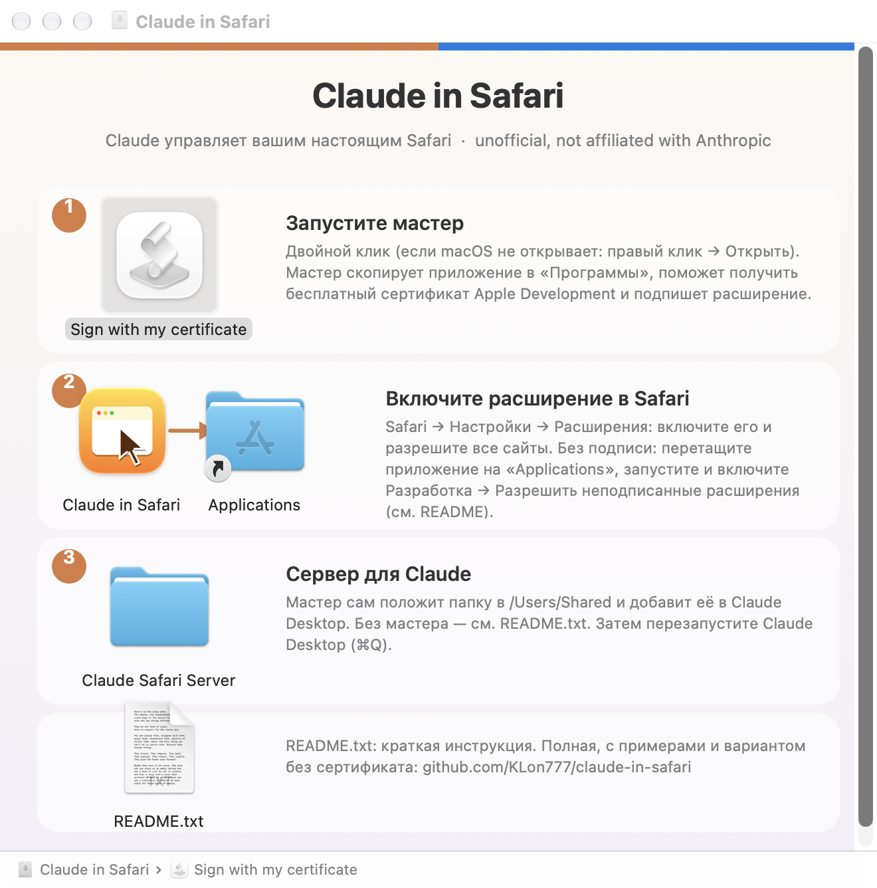

**2. Run the wizard** ("Sign with my certificate"). If macOS refuses to open it, right-click → Open. The wizard copies the app to Applications and the "Claude Safari Server" folder to `/Users/Shared`.

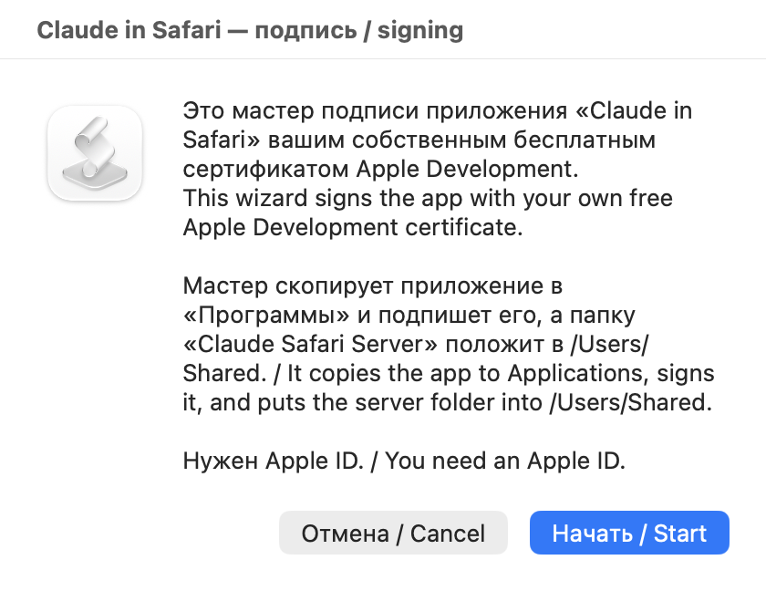

**3. Install Xcode** (free, ~10 GB, needed only to obtain the certificate). If Xcode is already installed, the wizard skips this step.

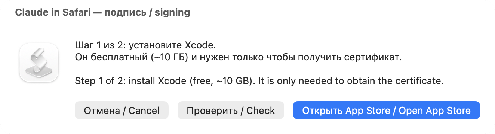

**4. Create a certificate.** The wizard opens Xcode and tells you what to do: Xcode → Settings → Apple Accounts → Sign In… (use your Apple ID).

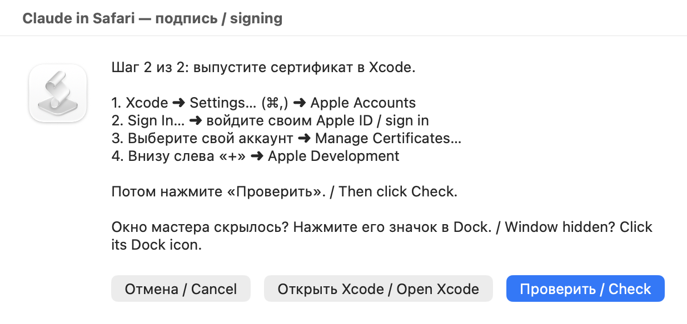
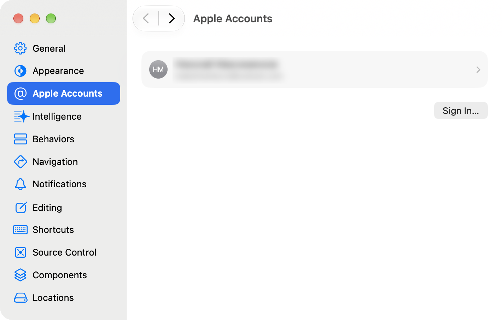

Then select the account, click "Personal Team ›" → **Manage Certificates…**

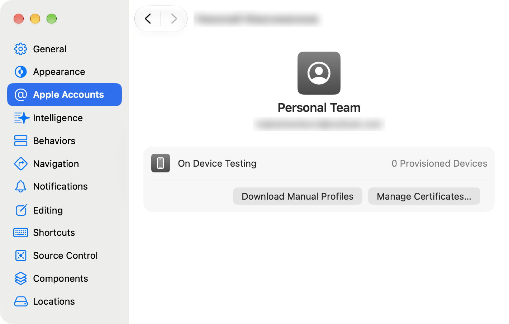

Click "+" → **Apple Development**; the certificate appears in the list.

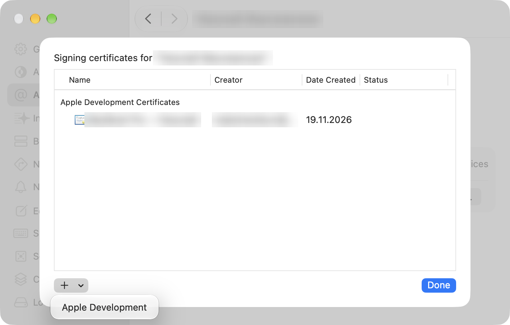

> **About the certificate.** Do not delete the Apple Development certificate from Keychain Access by hand: Apple keeps it as "Not in Keychain" and a new one may fail to issue ("You already have a current Development certificate or a pending certificate request"). In that case check the list in Xcode → Settings → Apple Accounts → Manage Certificates; signing out and back in may help. The certificate is valid for a year (365 days).

**5. Signing.** Go back to the wizard and click "Check". It finds the certificate and signs the app. If macOS asks for access to the key, choose "Always Allow".

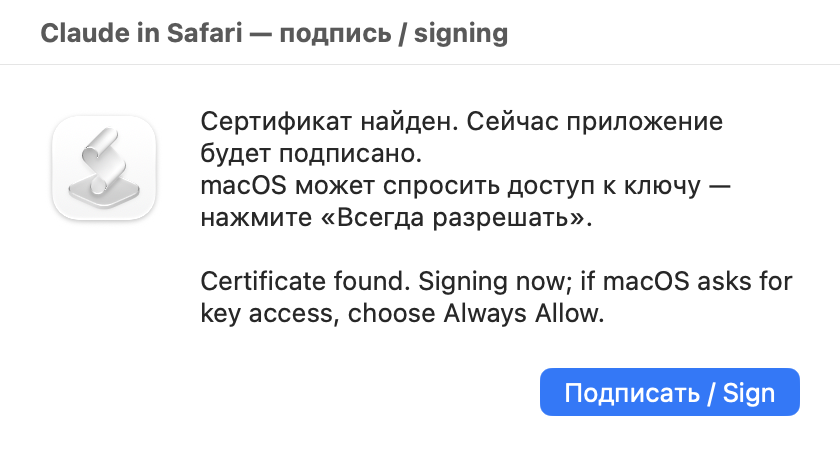
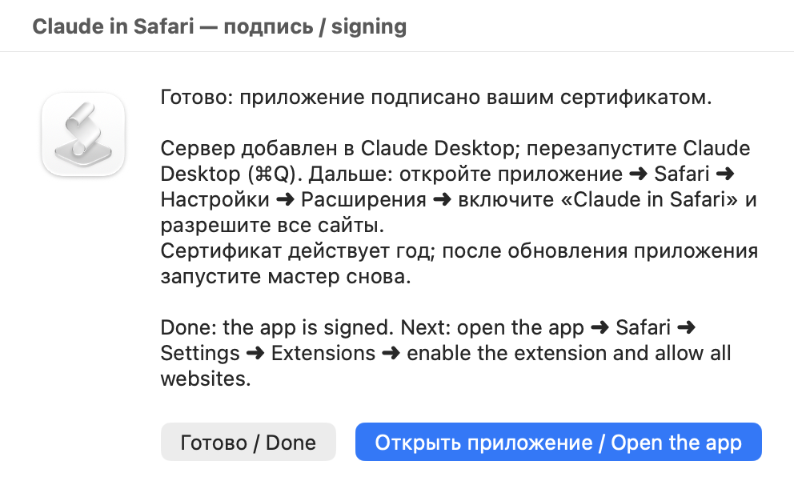

**6. Enable the extension.** Open the app (button in the wizard), then Safari → Settings → Extensions → turn on **Claude in Safari**.

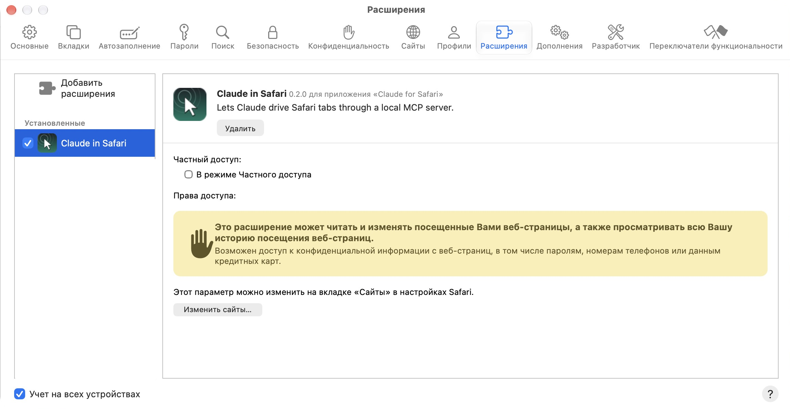

When Safari asks for permission the first time, choose "Always Allow on Every Website".

> **Limiting websites.** You can narrow access with Safari itself: instead of "on every website" pick "Allow for One Day" or "Always Allow on This Website", and manage the per-site list in Safari → Settings → Extensions → Claude in Safari → **"Edit Websites…"** (per site: ask / deny / allow). For banks, e-mail and other sensitive sites it makes sense to set "Deny": the extension then cannot see them, and Claude cannot work with them. A tab that was already open before the change may keep returning its text until it is reloaded, so for safety also use `blocked` in `policy.json`.

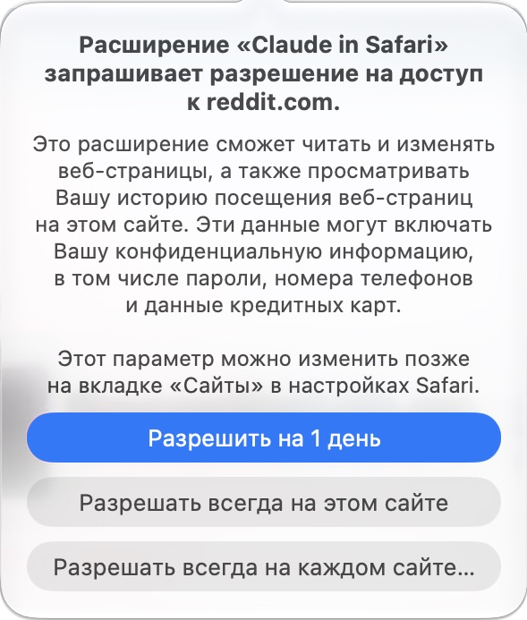

**7. Connect Claude Desktop.** The wizard has already added the server to `claude_desktop_config.json` (the previous file is kept as `.bak`). Just **fully** restart Claude Desktop (⌘Q, then open it again) and ask Claude to open any page in Safari, e.g. "Open example.com in Safari and tell me the page title".

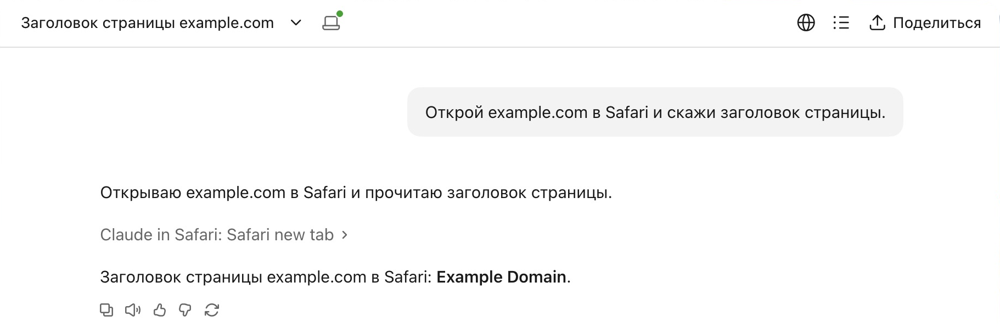

> Without the wizard: copy the folder from the image to `/Users/Shared` manually (Finder → Go → Go to Folder, Shift+Cmd+G; do not press "Replace" over an old copy, delete it first) and run `"/Users/Shared/Claude Safari Server/claude-safari-server" --install` in Terminal. You can also edit the config by hand, see "Connect to Claude" below.

### Option 1. Sign with your own certificate

Safari loads extensions from apps signed with an Apple developer certificate without asking. A free Apple ID is enough.

**Automatic:** double-click **Sign with my certificate** in the disk image (if macOS blocks it, right-click → Open). A wizard of native macOS dialogs copies the app to Applications, shows the path to the certificate with arrows ➜ right in the window (opens the App Store page for Xcode, then Xcode), waits for the certificate when you press "Check", signs the app and verifies the signature. Signing in with your Apple ID (two-factor authentication) and issuing the certificate is up to you. The same logic for Terminal lives in `tools/sign-app.command`. The same steps by hand follow.

1. Get a certificate: **Xcode → Settings → Apple Accounts → Sign In…** (use your Apple ID), then select the account and **Manage Certificates… → "+" → Apple Development**. Check with `security find-identity -v -p codesigning` — you should see `"Apple Development: you@email (XXXXXXXXXX)"`. (Xcode is only needed to obtain the certificate.)
2. Sign the app in Terminal:

   ```bash
   cd /Applications
   APP="Claude in Safari.app"
   xattr -cr "$APP"
   codesign --force --sign "Apple Development" --preserve-metadata=entitlements --options runtime "$APP"/Contents/PlugIns/*.appex
   codesign --force --sign "Apple Development" --preserve-metadata=entitlements --options runtime "$APP"
   codesign --verify --deep --strict "$APP" && echo "signed"
   ```

   `--preserve-metadata=entitlements` keeps the sandbox entitlement — without it Safari will not load the extension. On first use macOS asks for access to the key: choose "Always Allow". If you have several certificates, use the full name from `security find-identity` instead of `"Apple Development"`.
3. The certificate is valid for a year; then create a new one and repeat step 2. Sign again after every app update, too.

### Option 2. Unsigned (Safari's Develop menu)

1. Remove the macOS quarantine: `xattr -cr "/Applications/Claude in Safari.app"` (or System Settings → Privacy & Security → Open Anyway).
2. Safari → Settings → Advanced → "Show features for web developers".
3. In the menu bar choose **Develop → Allow Unsigned Extensions** (Mac password). Do this **after every Safari restart**.

### Option 3. Build from source

Requirements: macOS, Safari 16.4+, Xcode, an Apple ID (a free Personal Team is enough).

1. Clone the repo and install the server dependencies:
   ```bash
   git clone https://github.com/KLon777/claude-in-safari.git
   cd claude-in-safari
   swiftc -O -swift-version 5 -o claude-safari-server swift-server/main.swift swift-server/Tools.swift swift-server/Policy.swift
   ./claude-safari-server --install   # adds the server to Claude Desktop's config
   ```
2. Provide your Apple Team ID (Xcode: Settings → Apple Accounts) and build the app:
   ```bash
   echo XXXXXXXXXX > .team   # or export DEVELOPMENT_TEAM=XXXXXXXXXX
   ./rebuild.sh
   ```
   The app is installed to `~/Applications/Claude in Safari.app`.
3. Safari → Settings → Extensions → enable **Claude in Safari** and allow access to all websites. (If Safari asks, enable "Develop → Allow Unsigned Extensions" once.)

> The app is signed with your Apple Development certificate (free Personal Team, the certificate is valid for a year; no provisioning profile is embedded, so the 7-day limit does not apply). Re-run `./rebuild.sh` after code updates and when the certificate expires. If Xcode says the bundle identifier is taken, replace `local.claudeinsafari` with your own in all three places: `project.xcproj` (two `PRODUCT_BUNDLE_IDENTIFIER` entries), `ViewController.swift` and `extension/background.js`.

## Connect to Claude

The wizard or the command `claude-safari-server --install` adds the server to the config; then fully restart Claude Desktop (⌘Q and reopen). By hand, in `~/Library/Application Support/Claude/claude_desktop_config.json`:

```json
{
  "mcpServers": {
    "Claude in Safari": {
      "command": "/Users/Shared/Claude Safari Server/claude-safari-server"
    }
  }
}
```

## Testing

```bash
python3 -u tools/feature_test.py     # self-check of every feature, ends with PASS
python3 tools/make_screenshots.py    # regenerate the README screenshots
```

## Security: blocked sites and confirmations

`~/.claude-in-safari/policy.json` (created on first use, mode 0600) is read on every tool call, so edits apply at once with no restart.

```json
{
  "blocked": ["bank.example", "*.gosuslugi.ru"],
  "confirm": ["mail.example.com"],
  "confirmAll": false
}
```

- `blocked`: Claude cannot work with these sites. Every tool on such a tab is refused, `safari_new_tab` and `safari_navigate` to such an address are refused, and `safari_tabs` hides the title and URL of these tabs. The result of a navigation that ends on a blocked site (a redirect) is discarded.
- `confirm`: before an action (`click`, `type`, `key`, `form_input`, `eval`, `eval_page`, `navigate`, `new_tab`, `history`) on these sites a macOS dialog asks: Deny / Allow / This site until restart. No answer within 90 seconds means deny. Reading a page without acting is not asked about.
- `confirmAll: true`: the same for every site.
- `example.com` also matches subdomains; `*` matches everything, including pages without a host. Those are matched by scheme: `"file:"` (local files), `"favorites:"` (start page), `"about:"`. `blocked` wins over `confirm`.
- An invalid `policy.json` makes every tool refuse until the file is fixed. With an active policy, an extension older than the server (no `tab_info`) is refused too. Check the file with `claude-safari-server --policy`.
- With an active policy, tabs whose address Safari hides (a site set to Deny in the extension's website settings) are refused; the start page stays visible. The check uses the tab's address at call time; an iframe from another site inside an allowed page is not inspected. The policy does not stop prompt injection on allowed sites: use `blocked` or `confirm` for important accounts.

Policy tests: `python3 tools/policy_test.py <path to claude-safari-server>` (no Safari needed, 39 checks).

## Limitations

- Safari has no `chrome.debugger`, so clicks and typing are synthetic by default (`isTrusted=false`). For a real click use `safari_screen_point` plus a system-level tool.
- Pages with a strict CSP (GitHub, for example): console and network are recorded, but `safari_eval_page` answers with an `EvalError` (the page forbids eval); use `safari_eval` or `safari_read_page` there.
- Closed shadow roots are unreachable. `safari_screen_point` does not yet account for a frame's offset inside iframes.
- Sticky headers may repeat in full-page screenshots.
- Websites and foreign clients are blocked (Origin + token), but a local process of the same user can read the token. Site blocking and confirmations: see the Security section.
- MV3: the project stays on MV2, because the server needs the extension's persistent WebSocket and an MV3 background page goes to sleep. The page script already loads via `world: "MAIN"`; the inline injection remains only as a fallback for older Safari.

## Roadmap

Ideas, no dates:

- Per-tool rules, for example reading allowed while typing and clicking on a site need confirmation.
- An action log: what Claude did and on which sites.
- Checking an iframe's address in the policy, not only the tab's.
