<div align="center">


# Claude in Safari

**Расширение Safari + локальный MCP-сервер, которые позволяют Claude работать в вашем настоящем Safari — так же, как «Claude in Chrome» работает в Chrome.**

🇷🇺 Русский · [🇬🇧 English](README.en.md)

</div>

> ⚠️ **Неофициальный проект.** Не связан с Anthropic и не одобрен ей; «Claude» — торговая марка Anthropic.
>
> 🔐 **Безопасность.** Расширение даёт MCP-клиенту (Claude) управлять вашим *настоящим* Safari: видеть вкладки, читать страницы, нажимать и вводить текст там, где вы авторизованы. Включайте его, только если понимаете это. Порт защищён от сайтов (Origin + токен), а в `~/.claude-in-safari/policy.json` можно запретить сайты и включить подтверждение действий (см. «Безопасность» ниже). Для банков и админок задайте `blocked`.

Claude видит ваши вкладки, читает страницы, кликает, вводит текст, делает скриншоты и выполняет JavaScript — в том самом Safari, где вы уже залогинены. Никаких отдельных браузеров и повторных авторизаций.

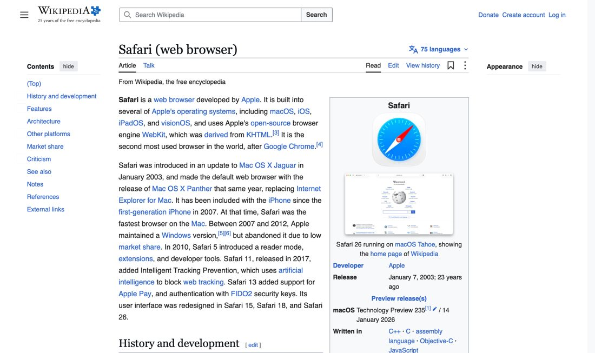

## Возможности

| Группа | Инструменты |
|---|---|
| Вкладки | `safari_tabs`, `safari_new_tab`, `safari_close_tab`, `safari_activate_tab`, `safari_navigate`, `safari_frames`, `safari_history` |
| Чтение страницы | `safari_read_page` (интерактивные элементы со ссылками-ref, фильтр `query`), `safari_get_text` |
| Действия | `safari_click` (left / double / right / hover, по ref или по x,y), `safari_type`, `safari_key` (с модификаторами), `safari_form_input`, `safari_scroll`, `safari_wait` |
| Скриншоты | `safari_screenshot`, `safari_fullpage_screenshot` (склейка всей страницы), `safari_resize` |
| Зрение | `safari_ocr` — распознавание текста через Apple Vision (русский + английский), координаты для клика по тексту на canvas и картинках |
| Отладка | `safari_console` (console.*, ошибки страницы), `safari_network` (fetch/XHR: метод, URL, статус, время) |
| JavaScript | `safari_eval` (изолированный мир расширения), `safari_eval_page` (мир самой страницы: `window`, переменные, фреймворки) |
| Системное | `safari_screen_point` — экранные координаты элемента для настоящего (trusted) клика системным инструментом |
| Структура и чтение | `safari_snapshot` (дерево страницы в стиле accessibility, с ref), `safari_reader` (основная статья в markdown) |
| Файлы и перетаскивание | `safari_upload_file` (файл с Mac в поле загрузки или dropzone), `safari_drag` (drag and drop), `safari_dialog` (alert/confirm/prompt) |
| Данные сайта | `safari_cookies`, `safari_storage` (localStorage/sessionStorage) — всегда с подтверждением |
| Экспорт | `safari_screenshot_element` (скриншот элемента), `safari_save_pdf` (страница целиком в PDF) |

Поддерживаются открытые shadow DOM и iframe, включая кросс-доменные: `safari_frames` показывает фреймы вкладки, а параметр `frame` в `read_page`, `click`, `type`, `get_text`, `eval_page` и др. направляет команду внутрь выбранного фрейма.

### Полностраничный скриншот

`safari_fullpage_screenshot` прокручивает страницу, делает снимки и склеивает их в одну картинку:

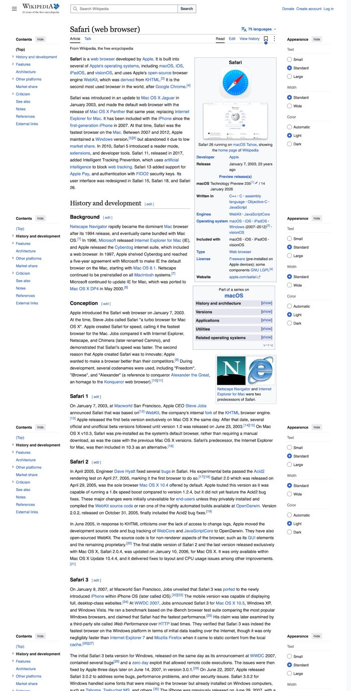

### Тестовая страница

В `tools/` лежит страница со всеми «неудобными» случаями (select, checkbox, shadow DOM, iframe, canvas) и скрипт самопроверки `tools/feature_test.py`:

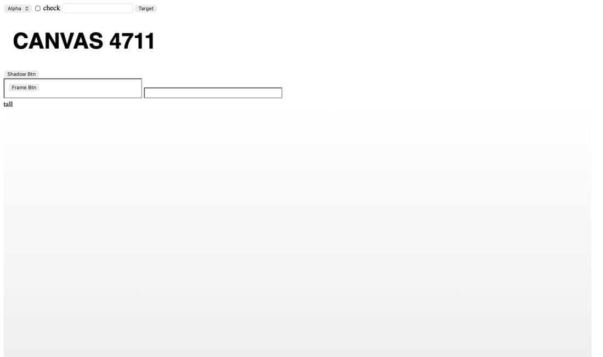

## Как это работает

```
Claude Desktop ──stdio──> MCP-сервер (Swift) ──WebSocket 127.0.0.1:18765──> расширение Safari ──> страница
                                                                              │
                                                                              └─ native messaging ─> Swift (Vision OCR)
```

- Первый запущенный экземпляр MCP-сервера занимает порт и становится «хабом»; остальные подключаются к нему как клиенты и пересылают запросы.
- Фоновая страница расширения держит WebSocket с автопереподключением.
- Всё работает только на `127.0.0.1`, наружу ничего не уходит.
- Доступ к порту ограничен: из браузера принимается только Origin самого расширения (обычные сайты всегда присылают свой Origin и получают отказ), остальные клиенты обязаны предъявить секрет из `~/.claude-in-safari/token` (создаётся автоматически, права 600).

## Установка из релиза

В релизе два образа: русский (`Claude-in-Safari-ru.dmg`: мастер, подсказки и README.txt на русском) и английский (`Claude-in-Safari-en.dmg`, см. [README.en.md](README.en.md)). Приложение и сервер в них одинаковые.

1. Скачайте `Claude-in-Safari-ru.dmg` из [Releases](https://github.com/KLon777/claude-in-safari/releases/latest), перетащите **Claude in Safari.app** в «Программы».
2. Приложение собрано без платного сертификата, поэтому Safari загрузит его расширение только после одного из вариантов ниже: **подписать своим сертификатом** (рекомендуется) или **включить неподписанные расширения**.
3. Запустите приложение → включите **Claude in Safari** в Safari → Настройки → Расширения и разрешите все сайты.
4. Мастер сам копирует «Claude Safari Server» в `/Users/Shared` и добавляет сервер в конфиг Claude Desktop; затем полностью перезапустите Claude Desktop (подробно — ниже).

## Пошаговая установка (с картинками)

Скриншоты сняты на русскоязычной macOS; названия пунктов на английском — в скобках.

**Что понадобится:** Mac с macOS и Safari 16.4+, бесплатный Apple ID, Claude Desktop.

**1. Откройте образ.** Скачайте `Claude-in-Safari-ru.dmg` из [Releases](https://github.com/KLon777/claude-in-safari/releases/latest) и дважды щёлкните по нему. В окне три шага.

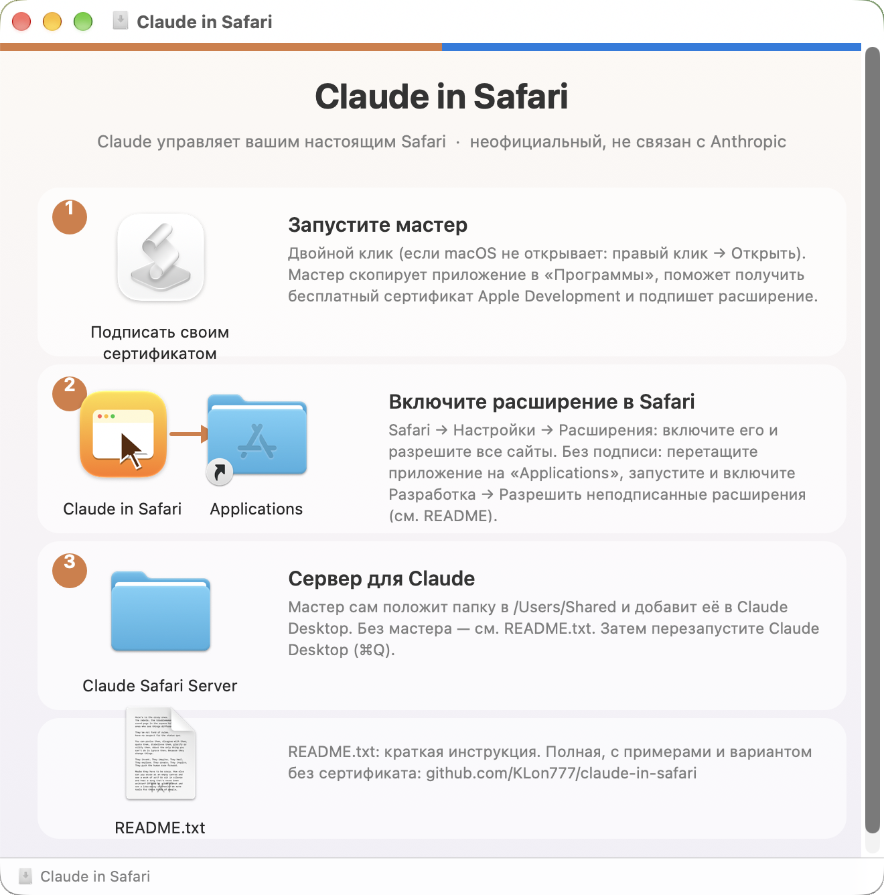

**2. Запустите мастер** («Подписать своим сертификатом»). Если macOS не открывает его, нажмите правой кнопкой → «Открыть». Мастер скопирует приложение в «Программы» (Applications), а папку «Claude Safari Server» — в `/Users/Shared`.

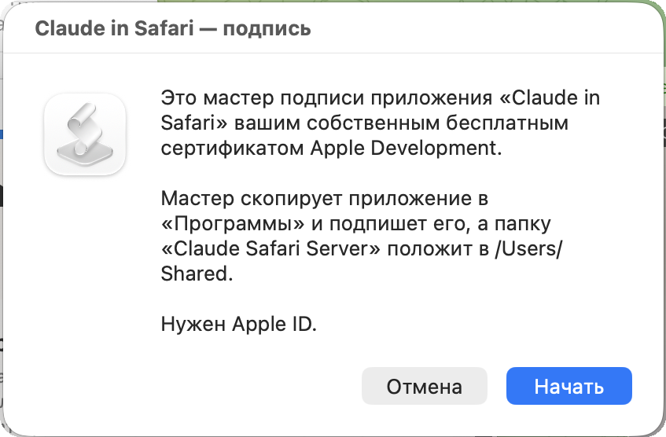

**3. Установите Xcode** (бесплатно, ~10 ГБ, нужен только ради сертификата). Если Xcode уже есть, мастер пропустит этот шаг.

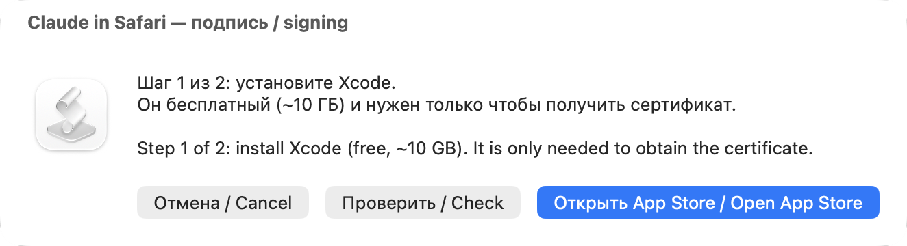

**4. Выпустите сертификат.** Мастер откроет Xcode и подскажет, что делать: Xcode → Settings → Apple Accounts → Sign In… (войдите своим Apple ID).

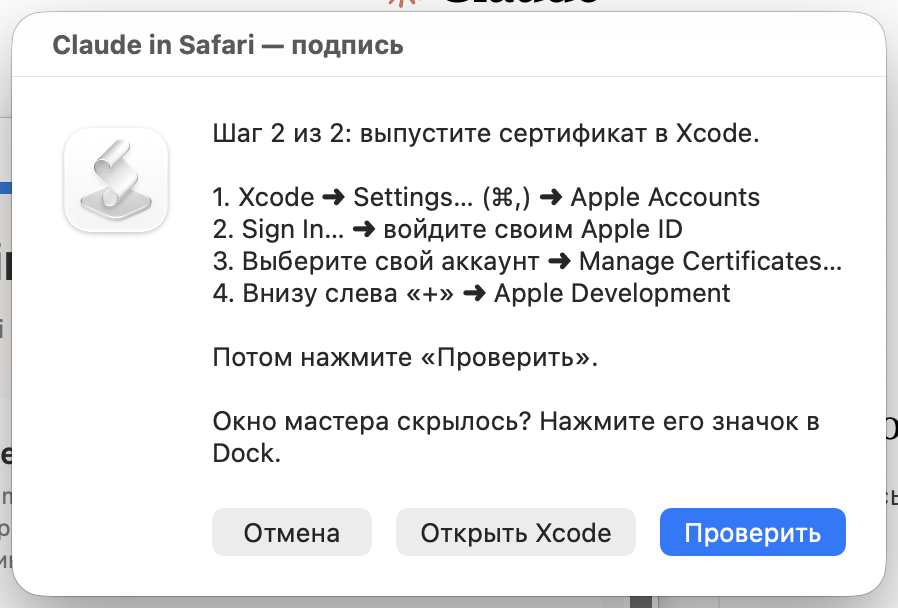
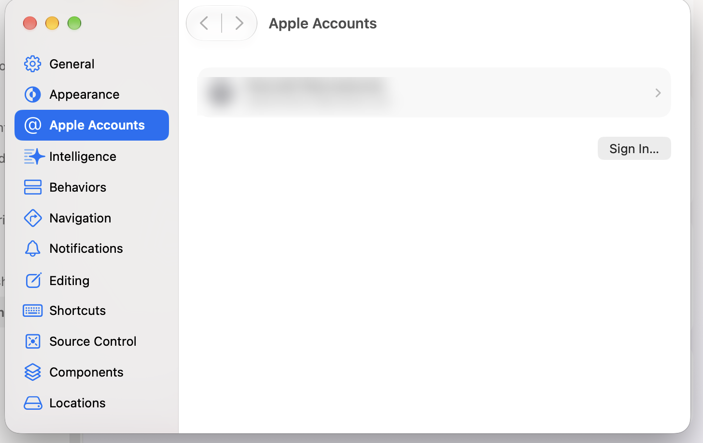

Затем выберите аккаунт и нажмите «Personal Team ›» → **Manage Certificates…**

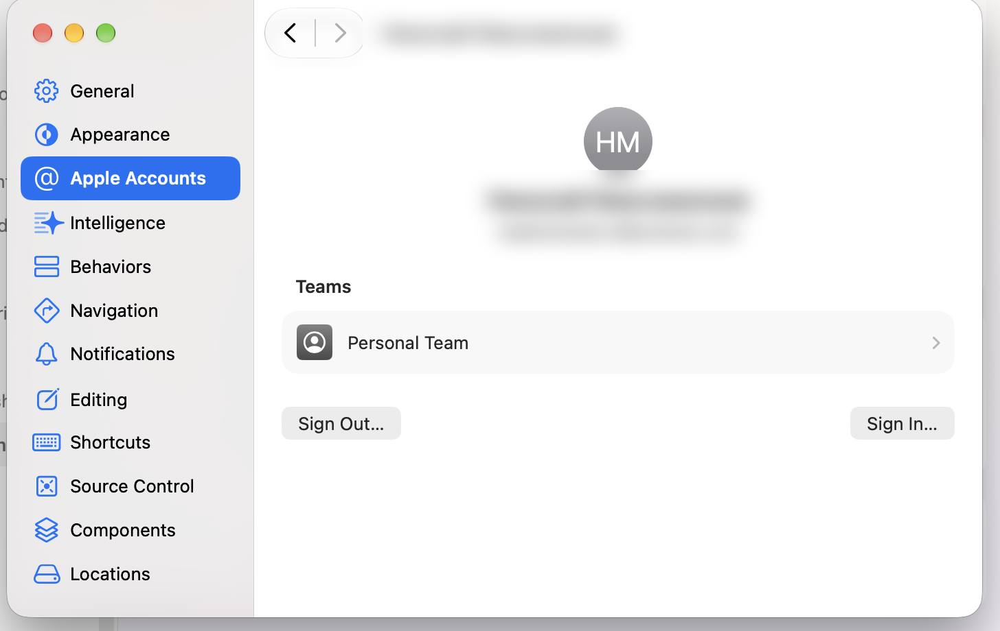
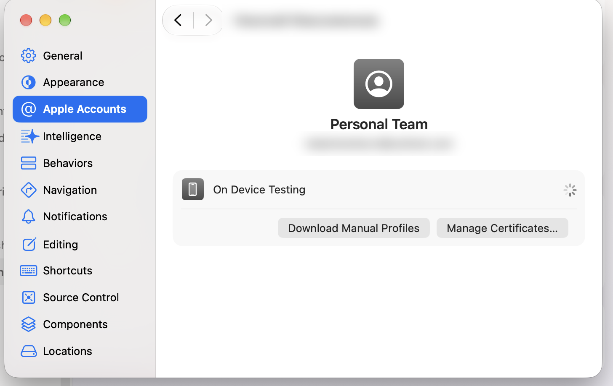

Нажмите «+» → **Apple Development**: сертификат появится в списке.

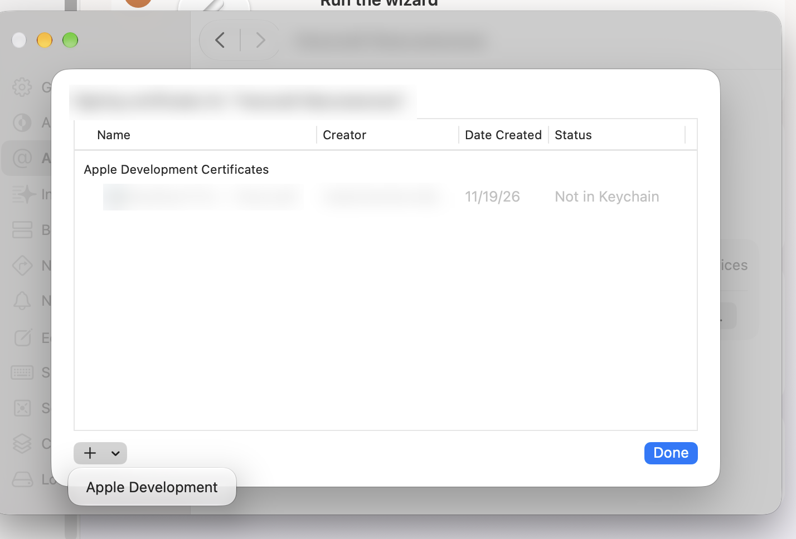
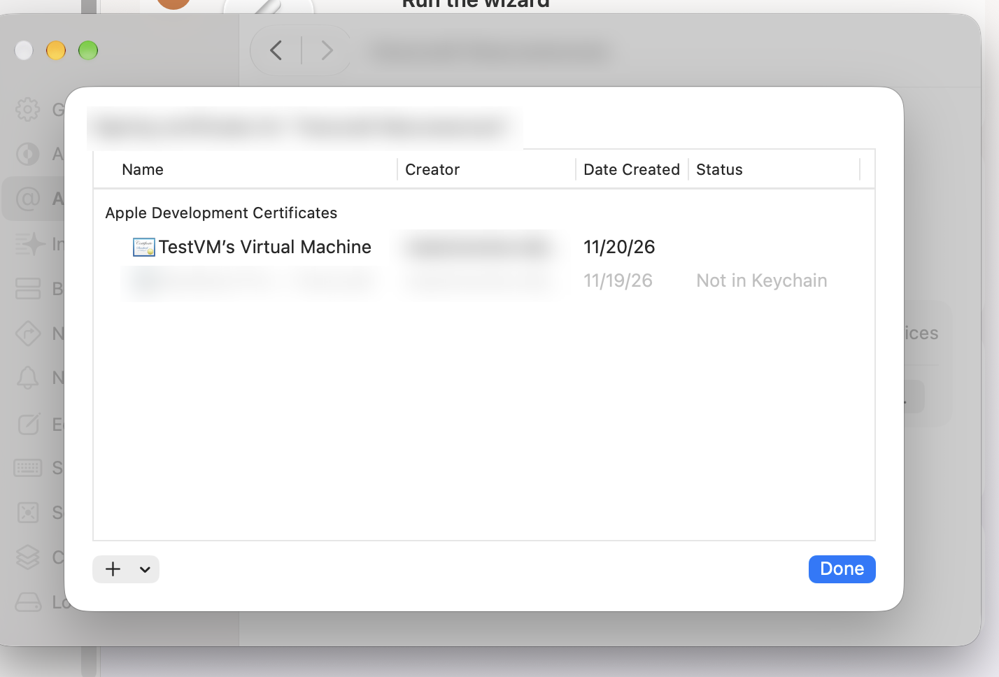


> **Важно про сертификат.** Не удаляйте сертификат Apple Development из «Связки ключей» вручную: на стороне Apple он остаётся как «Not in Keychain», и новый может не выпуститься (ошибка «You already have a current Development certificate or a pending certificate request»). В таком случае проверьте список в Xcode → Settings → Apple Accounts → Manage Certificates; может помочь выход из аккаунта и повторный вход. Сертификат действует год (365 дней).

**5. Подпись.** Вернитесь к мастеру и нажмите «Проверить». Он найдёт сертификат и подпишет приложение. Если macOS спросит доступ к ключу, выберите «Всегда разрешать».

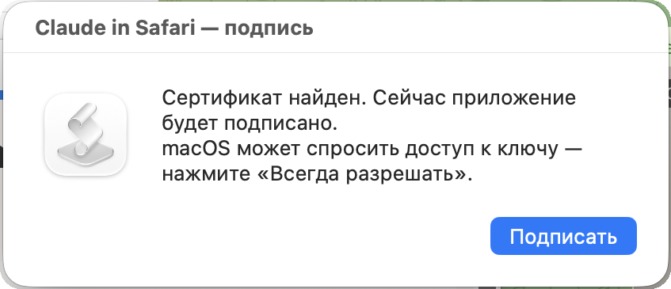
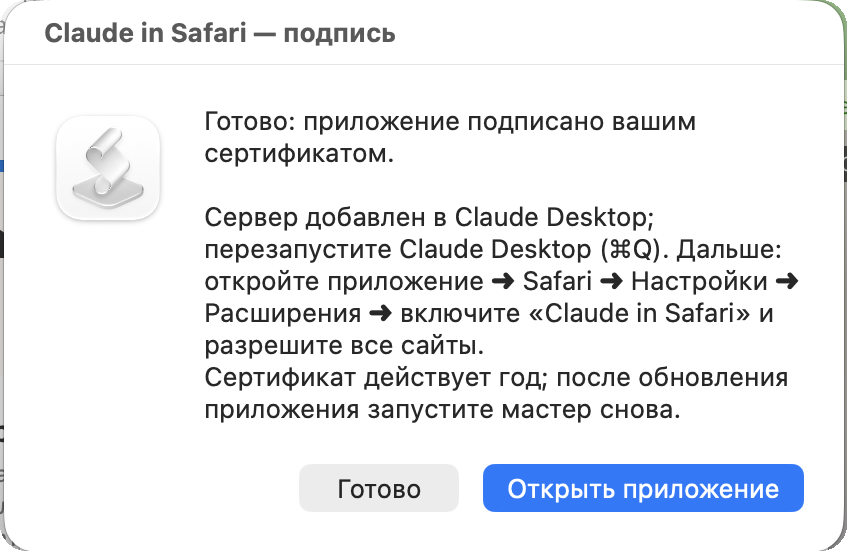

**6. Включите расширение.** Откройте приложение (кнопка в мастере), затем Safari → Настройки → Расширения (Settings → Extensions) → включите **Claude in Safari**.

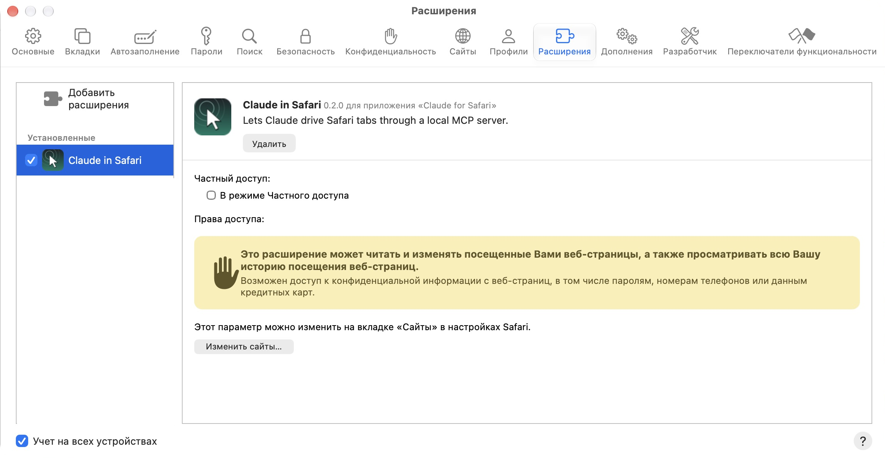

При первом открытии страницы Safari спросит разрешение для расширения: выберите «Разрешать всегда на каждом сайте» (Always Allow on Every Website).

> **Ограничить сайты.** Доступ можно сузить средствами самого Safari: вместо «на каждом сайте» выберите «Разрешить на 1 день» или «Разрешать всегда на этом сайте», а список сайтов настраивается в Safari → Настройки → Расширения → Claude in Safari → **«Изменить сайты…»** (для каждого сайта: спрашивать / запретить / разрешить). Для банков, почты и других чувствительных сайтов разумно поставить «Запретить»: тогда расширение их не увидит, и Claude с ними работать не сможет. Вкладка, которая была открыта до запрета, может ещё какое-то время отдавать текст, пока её не перезагрузят, поэтому для надёжности дополнительно используйте `blocked` в `policy.json`.

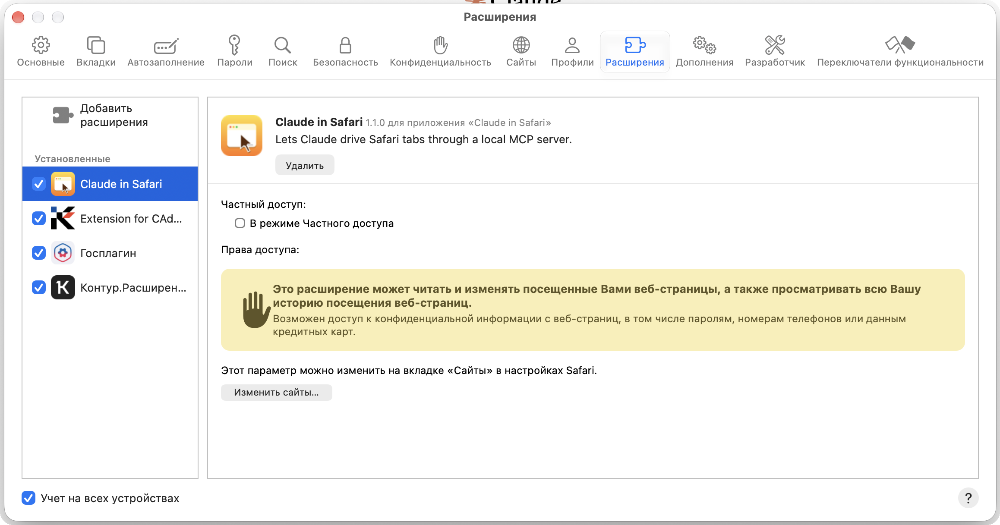

**7. Подключите Claude Desktop.** Мастер уже добавил сервер в `claude_desktop_config.json` (копия прежнего файла — `.bak`). Остаётся **полностью** перезапустить Claude Desktop (⌘Q, затем открыть снова) и попросить Claude открыть любую страницу в Safari, например: «Открой example.com в Safari и скажи заголовок страницы».

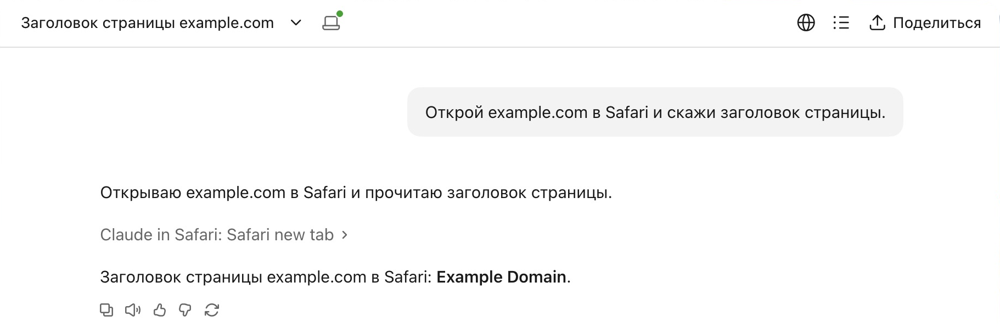

> Без мастера: скопируйте папку из образа в `/Users/Shared` вручную (Finder → Переход → Переход к папке, Shift+Cmd+G; не нажимайте «Заменить» поверх старой — сначала удалите её) и выполните в Терминале `"/Users/Shared/Claude Safari Server/claude-safari-server" --install`. Конфиг можно править и вручную — см. «Подключение к Claude» ниже.

### Вариант 1. Подписать своим сертификатом

Safari без вопросов загружает расширения из приложений, подписанных сертификатом разработчика Apple. Хватит бесплатного Apple ID.

**Автоматически:** дважды щёлкните **«Подписать своим сертификатом»** в образе (если macOS блокирует — правый клик → «Открыть»). Мастер из диалогов macOS скопирует приложение в «Программы», подскажет путь к сертификату (откроет App Store с Xcode, затем Xcode; шаги со стрелками ➜ прямо в окне), дождётся сертификата по кнопке «Проверить», подпишет приложение и проверит подпись. Вход в Apple ID с двухфакторной проверкой и выпуск сертификата — ваши руки. Для Терминала есть та же логика в `tools/sign-app.command`. Ниже — то же самое вручную.

1. Получите сертификат: **Xcode → Settings → Apple Accounts → Sign In…** (войдите своим Apple ID), затем выберите аккаунт и **Manage Certificates… → «+» → Apple Development**. Проверьте: `security find-identity -v -p codesigning` — должна быть строка `"Apple Development: ваш@email (XXXXXXXXXX)"`. (Xcode нужен только ради сертификата.)
2. Подпишите приложение в Терминале:

   ```bash
   cd /Applications
   APP="Claude in Safari.app"
   xattr -cr "$APP"
   codesign --force --sign "Apple Development" --preserve-metadata=entitlements --options runtime "$APP"/Contents/PlugIns/*.appex
   codesign --force --sign "Apple Development" --preserve-metadata=entitlements --options runtime "$APP"
   codesign --verify --deep --strict "$APP" && echo "подписано"
   ```

   `--preserve-metadata=entitlements` сохраняет разрешения (песочницу) — без него Safari расширение не загрузит. При первой подписи macOS спросит доступ к ключу: нажмите «Всегда разрешать». Если сертификатов несколько, вместо `"Apple Development"` укажите полное имя из `security find-identity`.
3. Сертификат действует год; потом выпустите новый и повторите шаг 2. Подписывать заново нужно и после каждого обновления приложения.

### Вариант 2. Без подписи (через меню разработчика Safari)

1. Снимите блокировку macOS: `xattr -cr "/Applications/Claude in Safari.app"` (или «Системные настройки → Конфиденциальность и безопасность → Всё равно открыть»).
2. Safari → Настройки → Дополнения → «Показывать функции для веб-разработчиков».
3. В меню **Разработка → Разрешить неподписанные расширения** (пароль Mac). Делать это нужно **после каждого перезапуска Safari**.

### Вариант 3. Собрать из исходников

Нужны: macOS, Safari 16.4+, Xcode, Apple ID (бесплатного Personal Team достаточно).

1. Клонируйте репозиторий и соберите сервер:
   ```bash
   git clone https://github.com/KLon777/claude-in-safari.git
   cd claude-in-safari
   swiftc -O -swift-version 5 -o claude-safari-server swift-server/main.swift swift-server/Tools.swift swift-server/Policy.swift swift-server/Extras.swift
   ./claude-safari-server --install   # добавляет сервер в конфиг Claude Desktop
   ```
2. Укажите свой Apple Team ID (в Xcode: Settings → Apple Accounts) и соберите приложение:
   ```bash
   echo XXXXXXXXXX > .team   # или export DEVELOPMENT_TEAM=XXXXXXXXXX
   ./rebuild.sh
   ```
   Приложение появится в `~/Applications/Claude in Safari.app`.
3. Safari → Настройки → Расширения → включите **Claude in Safari** и разрешите доступ ко всем сайтам. (Нужно один раз включить «Разработка → Разрешить неподписанные расширения», если Safari попросит.)

> Приложение подписывается вашим сертификатом Apple Development (бесплатный Personal Team, сертификат действует год; профиль в приложение не встраивается, поэтому срок в 7 дней не применяется). Пересобирайте `./rebuild.sh` после обновления кода и когда сертификат истечёт. Если Xcode пишет, что bundle identifier занят, замените `local.claudeinsafari` на свой во всех трёх местах: `project.xcproj` (две записи `PRODUCT_BUNDLE_IDENTIFIER`), `ViewController.swift` и `extension/background.js`.

## Подключение к Claude

Сервер добавляет в конфиг мастер или команда `claude-safari-server --install`; после этого полностью перезапустите Claude Desktop (⌘Q и открыть снова). Вручную в `~/Library/Application Support/Claude/claude_desktop_config.json`:

```json
{
  "mcpServers": {
    "Claude in Safari": {
      "command": "/Users/Shared/Claude Safari Server/claude-safari-server"
    }
  }
}
```

### Чтобы Claude всегда работал в Safari, а не в Chrome

Если у вас стоит и расширение «Claude in Chrome», Claude может выбрать Chrome. Два шага:

1. **Отключите Claude in Chrome**: в Chrome откройте `chrome://extensions` и выключите (или удалите) «Claude» — либо отключите соответствующий коннектор/расширение в настройках Claude.
2. **Добавьте инструкцию.** В Claude: Настройки → Профиль → «Персональные предпочтения» (или инструкции проекта) вставьте:

```text
Для любых задач в браузере всегда используй Safari через MCP-сервер «Claude in Safari» (инструменты safari_*:
safari_navigate, safari_read_page, safari_snapshot, safari_click, safari_type, safari_screenshot и т. д.).
Не используй Claude in Chrome и не открывай Chrome, даже если сайт не назван.
Если инструментов safari_* нет или расширение не подключено, не переключайся на Chrome: скажи об этом и подскажи,
как включить расширение «Claude in Safari» (Safari → Настройки → Расширения).
```

## Проверка

```bash
python3 -u tools/feature_test.py     # самопроверка всех функций, в конце PASS
python3 tools/make_screenshots.py    # пересоздать скриншоты для README
```

## Безопасность: запрещённые сайты и подтверждения

Файл `~/.claude-in-safari/policy.json` (создаётся при первом вызове, права 0600) читается при каждом вызове инструмента: правки действуют сразу, перезапуск не нужен.

```json
{
  "blocked": ["bank.example", "*.gosuslugi.ru"],
  "confirm": ["mail.example.com"],
  "confirmAll": false
}
```

- `blocked` — Claude не может работать с этими сайтами: любой инструмент на такой вкладке отказывает, `safari_new_tab` и `safari_navigate` на такой адрес отказывают, а в `safari_tabs` у этих вкладок скрыты заголовок и адрес. Результат навигации, закончившейся на запрещённом сайте (редирект), отбрасывается.
- `confirm` — перед действием (`click`, `type`, `key`, `form_input`, `eval`, `eval_page`, `navigate`, `new_tab`, `history`) на этих сайтах показывается окно macOS: «Запретить / Разрешить / Этот сайт до перезапуска». Без ответа 90 секунд — отказ. Чтение страницы без действий не спрашивает.
- `confirmAll: true` — то же для всех сайтов.
- `example.com` покрывает и поддомены; `*` — всё, включая страницы без хоста. Такие страницы задаются схемой: `"file:"` (локальные файлы), `"favorites:"` (начальная страница), `"about:"`. `blocked` сильнее `confirm`.
- Ошибка в `policy.json` (невалидный JSON) — все инструменты отказывают, пока файл не исправлен. Если расширение старее сервера и не умеет `tab_info`, при активной политике инструменты тоже отказывают. Проверить файл: `claude-safari-server --policy`.
- Вкладки, чей адрес скрыт Safari (сайт со статусом «Запретить» в настройках расширения), при активной политике отказывают; стартовая страница видна. Проверка идёт по адресу вкладки в момент вызова; iframe с другого сайта внутри разрешённой страницы не проверяется. Политика не защищает от prompt injection на разрешённых сайтах: для важных аккаунтов используйте `blocked` или `confirm`.

Тесты политики: `python3 tools/policy_test.py <путь к claude-safari-server>` (без Safari, 39 проверок).

## Ограничения

- Safari не умеет `chrome.debugger`, поэтому клики и ввод по умолчанию синтетические (`isTrusted=false`). Для настоящего клика используйте `safari_screen_point` + системный инструмент.
- Страницы со строгим CSP (GitHub, например): консоль и сеть записываются, но `safari_eval_page` отвечает ошибкой `EvalError` (страница запрещает eval) — используйте `safari_eval` или `safari_read_page`.
- Закрытые shadow root недоступны. Для `safari_screen_point` внутри iframe смещение фрейма пока не учитывается.
- В полностраничном скриншоте залипающие шапки могут повторяться.
- Защита от сайтов и чужих клиентов есть (Origin + токен), но локальный процесс того же пользователя может прочитать токен. Запрет сайтов и подтверждения — см. раздел «Безопасность».
- MV3: проект остаётся на MV2, потому что серверу нужно постоянное WebSocket-соединение расширения, а фоновая страница MV3 засыпает. Скрипт страницы уже грузится через `world: "MAIN"`; встроенная вставка осталась только запасным вариантом для старых Safari.

## Планы

Идеи без сроков:

- Правила по инструментам: например, чтение разрешено, а ввод и клики на сайте только с подтверждением.
- Журнал действий: что Claude делал и на каких сайтах.
- Проверка адреса iframe в политике, а не только вкладки.
